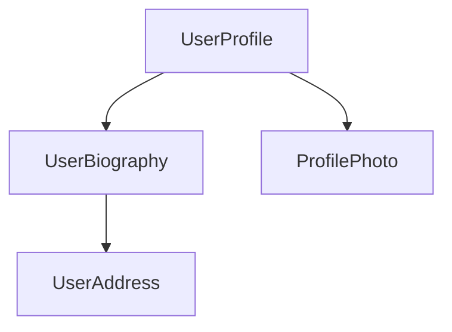

<docs-decorative-header title="Komponentlar" imgSrc="adev/src/assets/images/components.svg"> <!-- markdownlint-disable-line -->
Angular'da ilovalar yaratishning asosiy qurilish bloki.
</docs-decorative-header>

Komponentlar — Angular ilovalarining asosiy qurilish bloklari. Har bir komponent kattaroq veb-sahifaning bir qismini ifodalaydi. Ilovani komponentlarga ajratish loyihangizga tuzilma beradi va kodni vaqt oʻtishi bilan saqlash va kengaytirish oson boʻlgan aniq qismlarga ajratadi.

## Komponentni aniqlash {#defining-a-component}

Har bir komponent bir nechta asosiy qismlardan iborat:

1. Angular foydalanadigan baʼzi konfiguratsiyalarni oʻz ichiga olgan `@Component` [dekoratori](https://www.typescriptlang.org/docs/handbook/decorators.html).
2. DOM'ga nima render qilinishini boshqaradigan HTML shablon.
3. Komponent HTML'da qanday ishlatilishini belgilaydigan [CSS selektor](https://developer.mozilla.org/docs/Learn/CSS/Building_blocks/Selectors).
4. Foydalanuvchi kiritmalarini qayta ishlash yoki serverga soʻrov yuborish kabi xatti-harakatlarga ega TypeScript klassi.

Quyida `UserProfile` komponentining soddalashtirilgan misoli keltirilgan.

```angular-ts {header: "user-profile.ts"}
@Component({
  selector: 'user-profile',
  template: `
    <h1>User profile</h1>
    <p>This is the user profile page</p>
  `,
})
export class UserProfile {
  /* Your component code goes here */
}
```

`@Component` dekoratori shuningdek shablonga qoʻllamoqchi boʻlgan har qanday CSS uchun ixtiyoriy `styles` xususiyatini ham qabul qiladi:

```angular-ts {header: "user-profile.ts"}
@Component({
  selector: 'user-profile',
  template: `
    <h1>User profile</h1>
    <p>This is the user profile page</p>
  `,
  styles: `
    h1 {
      font-size: 3em;
    }
  `,
})
export class UserProfile {
  /* Your component code goes here */
}
```

### HTML va CSS'ni alohida fayllarga ajratish {#separating-html-and-css-into-separate-files}

`templateUrl` va `styleUrl` yordamida komponentning HTML va CSS'ini alohida fayllarda aniqlashingiz mumkin:

```angular-ts {header: "user-profile.ts"}
@Component({
  selector: 'user-profile',
  templateUrl: 'user-profile.html',
  styleUrl: 'user-profile.css',
})
export class UserProfile {
  // Component behavior is defined in here
}
```

```angular-html {header: "user-profile.html"}
<h1>User profile</h1>
<p>This is the user profile page</p>
```

```css {header: "user-profile.css"}
h1 {
  font-size: 3em;
}
```

## Komponentlardan foydalanish {#using-components}

Ilovani bir nechta komponentlarni birlashtirish orqali qurasiz. Masalan, foydalanuvchi profili sahifasini yaratayotgan boʻlsangiz, sahifani quyidagicha bir nechta komponentlarga boʻlishingiz mumkin:



Bu yerda `UserProfile` komponenti yakuniy sahifani hosil qilish uchun bir nechta boshqa komponentlardan foydalanadi.

Komponentni import qilish va ishlatish uchun:

1. Komponentingizning TypeScript faylida ishlatmoqchi boʻlgan komponent uchun `import` ifodasini qoʻshing.
2. `@Component` dekoratoringizda ishlatmoqchi boʻlgan komponentni `imports` massiviga qoʻshing.
3. Komponentingiz shablonida ishlatmoqchi boʻlgan komponent selektoriga mos keladigan element qoʻshing.

Quyida `ProfilePhoto` komponentini import qilayotgan `UserProfile` komponentiga misol:

```angular-ts {header: "user-profile.ts"}
import {ProfilePhoto} from './profile-photo';

@Component({
  selector: 'user-profile',
  imports: [ProfilePhoto],
  template: `
    <h1>User profile</h1>
    <profile-photo />
    <p>This is the user profile page</p>
  `,
})
export class UserProfile {
  // Component behavior is defined in here
}
```

TIP: Angular komponentlari haqida koʻproq bilmoqchimisiz? Toʻliq maʼlumot uchun [Komponentlar boʻyicha chuqur qoʻllanmaga](guide/components) qarang.

## Keyingi qadam {#next-step}

Angular'da komponentlar qanday ishlashini bilib oldingiz, endi ilovamizga dinamik maʼlumotlarni qanday qoʻshish va boshqarishni oʻrganish vaqti keldi.

<docs-pill-row>
  <docs-pill title="Signallar bilan reaktivlik" href="essentials/signals" />
  <docs-pill title="Komponentlar boʻyicha chuqur qoʻllanma" href="guide/components" />
</docs-pill-row>
